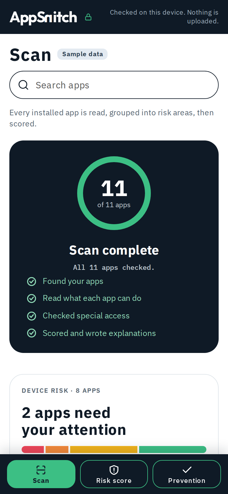
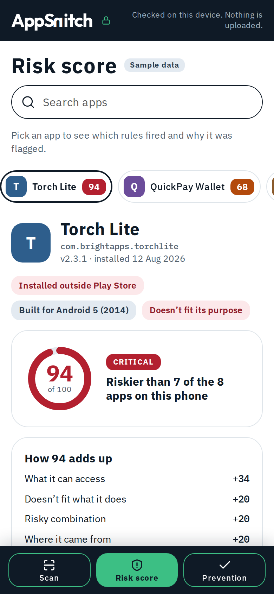
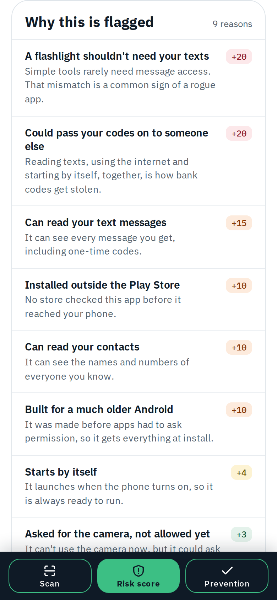
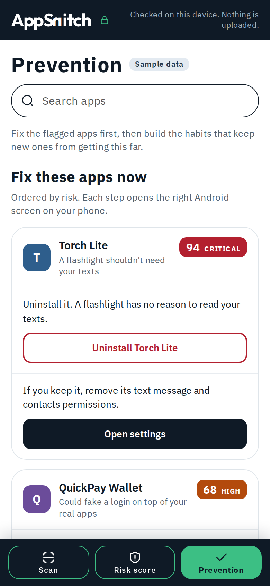

<div align="center">

# AppSnitch

**Empowering non-technical users to instantly audit mobile threat exposure on-device.**

PS-01 · Mobile Security · On-Device App Risk Auditor
 


</div>

<p align="center">
  
  
  
  
</p>
<p align="center"><sub>Scan · Risk score · Why flagged · Prevention (phone UI on bundled sample data)</sub></p>

AppSnitch scans every installed app on an Android phone and reads what each one is *allowed* to do. It groups those abilities into risk categories, turns them into a 0–100 score with plain-language reasons, and gives the user a button to act on it. **Everything runs on the device and nothing is uploaded.**

---

## The problem

Android permissions are opaque constants. Average users can't judge the threat, or tell which background components put their data at risk. AppSnitch turns them into something clear by answering three questions, which double as the project's acceptance test:

| | Question | Where the app answers it |
|---|---|---|
| **Q1** | Which of my apps can do the most harm? | Home list sorted by risk score, colour-banded |
| **Q2** | Why is each one flagged? | "Why flagged" panel: plain-language reasons, no raw permission constants |
| **Q3** | What can I do about it right now? | One-tap actions: open the app's system settings, or uninstall |

If someone can open the app and answer all three in under 60 seconds without anyone explaining it, it works.

## How it works

Data flows one way through five layers. Layers 1–4 are pure Kotlin with no Android UI imports, so the scoring engine can be unit-tested with fake data.

```
┌──────────────────────────────────────────────────┐
│ 5. UI          Scan · Risk score · Prevention    │
├──────────────────────────────────────────────────┤
│ 4. Explain     Reason objects → plain sentences  │
├──────────────────────────────────────────────────┤
│ 3. Score       Base weights + combo rules → 0-100│
├──────────────────────────────────────────────────┤
│ 2. Categorize  Permission → one of 9 categories  │
├──────────────────────────────────────────────────┤
│ 1. Collect     Inventory · Permissions · AppOps  │
└──────────────────────────────────────────────────┘
```

1. **Collect.** Enumerate installed apps through `PackageManager` (name, version, install date, installer source, target SDK, system flag). Split each app's permissions into **declared vs granted**. Detect the six kinds of special access: accessibility, notification listener, device admin, overlay, install packages and usage stats.
2. **Categorize.** Map every permission into one of nine categories: SMS · contacts & call logs · camera & mic · location · phone & identity · storage & media · background & persistence · network · special access. Also build a device-wide summary, e.g. *"14 apps can read your SMS · 3 apps can record audio · 2 apps can read your screen"*.
3. **Score.** Apply base weights, then combination bonuses, context mismatch and trust modifiers. Clamp to 0–100 and assign a band.
4. **Explain.** Every scoring rule that fires emits its own `Reason`, so the number and the words can never disagree. High and Critical apps always get at least three reasons, worst first.
5. **Act.** Deep links to the app's settings page, the uninstall prompt, and the special-access screens users rarely find on their own (accessibility, overlay, notification listener, unknown sources).

## Scoring: a four-stage risk engine

### Bands

| Score | Band |
|---|---|
| 0–24 | 🟢 Low |
| 25–49 | 🟡 Medium |
| 50–74 | 🟠 High |
| 75–100 | 🔴 Critical |

### 1. Base weights

| Category | Weight | Notes |
|---|---:|---|
| Special access | 25 each | Accessibility, device admin and notification listener weigh most |
| SMS | 15 | Category capped at 20 |
| Contacts & call logs | 10 | |
| Camera & microphone | 10 | |
| Location | 8 | Background location adds +5 |
| Phone & identity | 6 | |
| Storage & media | 6 | All-files access counts 12 |
| Background & persistence | 4 | |
| Network | 2 | Low on its own, an amplifier in combinations |

- **Declared but not granted** counts at **25%** weight. That's latent risk, not active risk, and the reason text says so.
- **Diminishing returns:** the second and later permissions in one category count at **50%**, so an app with five storage permissions can't outscore one with an accessibility service.

### 2. Combination rules: known malware tactics

| Rule | Bonus | Why it matters |
|---|---:|---|
| Accessibility + overlay | +25 | Classic banking-trojan pair: read the screen, then draw a fake login over the real app |
| SMS read + internet + boot persistence + sideloaded | +20 | OTP interception and exfiltration chain |
| Device admin on a non-security / non-MDM app | +15 | Can block its own uninstall |
| Notification listener + internet | +15 | Captures OTPs from the notification shade |
| Accessibility + SMS | +15 | Screen reading plus message access |
| Overlay + install packages | +10 | A fake prompt that leads to a dropper install |
| Any special access + sideloaded | +10 | Powerful access with no store vetting |

### 3. Context mismatch: the torch trap

Some apps are torches, scanners, calculators, wallpapers, clocks, notepads or games. If one of them holds SMS, contacts, camera/mic or special access, it gets **+20** and a **forced minimum band of High**. Simple tools rarely need message access, so a mismatch like this is a strong sign of a rogue app, and the band floor makes sure it shows up at the top of the list. System apps are exempt. The check runs offline, using `ApplicationInfo.category` and keyword buckets on the app's label.

### 4. Trust modifiers

| Signal | Effect |
|---|---|
| Sideloaded (installed outside an official store) | +10 |
| Legacy `targetSdk < 23` (predates runtime permissions, gets everything at install) | +10 |
| Installed from Google Play | −10 |
| System app | −15, floored at 0 |

> [!NOTE]
> The numbers above are the design from the PS-01 plan and pitch deck. The engine reads its tuned values from [`rubric.json`](risk-auditor/scoring/src/main/resources/rubric.json). For example, it puts the band thresholds at **30 / 60 / 80** and caps ordinary permissions at 45 points. [`SCORING_RUBRIC.md`](risk-auditor/docs/SCORING_RUBRIC.md) is generated from that file and lists the values the app actually runs with.

## Privacy and hard constraints

| | |
|---|---|
| **On-device execution** | No root and no ADB: only standard public APIs (`PackageManager`, `AppOpsManager`, `Settings.Secure`) |
| **Zero data leaves the device** | No analytics, no crash-reporting SDKs, no cloud uploads |
| **Offline first** | Scanning, scoring and explanations all work in airplane mode |
| **Full visibility** | `QUERY_ALL_PACKAGES` is declared. Without it, Android 11+ shows almost nothing |
| **No live malware** | Demonstrated on benign but over-permissioned apps |
| **Optional hash lookups** | Sends only a SHA-256 fingerprint, strictly opt-in with explicit consent |

The rules are generic. No package name is hardcoded, allow-listed or tuned for, so the scorer holds up on apps it has never seen.

## Repository layout

```
.
├── appsnitch/              Phone UI: framework-free HTML/CSS/JS, wrapped as an APK with Capacitor
│   ├── www/                the app itself (open www/index.html in a browser)
│   ├── native/android/     AppScanner Capacitor plugin (Kotlin bridge to the engine)
│   ├── docs/               DATA-CONTRACT.md and sample-scan.json
│   ├── tools/              dependency-free mock backend
│   └── tests/              band check and 127 phone-size browser checks
├── risk-auditor/           On-device risk engine: multi-module Gradle project in Kotlin
│   ├── core-model/ catalog/ trust/ context/ scoring/ …    pure Kotlin, testable without a device
│   ├── inventory/ permissions/ special-access/ …          Android collectors
│   ├── app/                wiring and headless debug entry point
│   ├── fixture-apps/       inert test APKs (dev only, never shipped)
│   └── docs/               scoring rubric, demo script, traceability, limitations
├── docs/
│   ├── PLAN.md                           requirements and build logic for PS-01
│   ├── AppSnitch-App-Risk-Auditor.pptx   pitch deck
│   ├── INTEGRATION.md                    how the UI and the engine connect
│   └── screenshots/
└── LICENSE
```

## Getting started

### Try the UI (nothing to install)

Open `appsnitch/www/index.html` in a browser at phone width (360–412 px in DevTools device mode). It runs on bundled sample data. More options, including a mock backend, are in [`appsnitch/README.md`](appsnitch/README.md).

```bash
node appsnitch/tests/band_check.js
```

### Build and test the engine

Requires JDK 17+, the Android SDK (API 36), and network access to Maven Central and Google Maven.

```bash
cd risk-auditor
./gradlew test                 # JVM unit tests
scripts/run_all_tests.sh       # offline harness, ML, Gradle and traceability checks
scripts/build_apk.sh           # builds dist/risk-auditor-debug.apk
```

The headless on-device run, the test fixtures and the module map are covered in [`risk-auditor/README.md`](risk-auditor/README.md).

### Connect the UI to the engine

Add Capacitor to `appsnitch/`, register `AppScannerPlugin`, and set `dataSource: 'native'` in `appsnitch/www/js/config.js`. Step-by-step instructions and the field mapping are in [`docs/INTEGRATION.md`](docs/INTEGRATION.md).

## Project status

| Area | State |
|---|---|
| Phone UI | Runs on sample data, mock HTTP and a stubbed native plugin. 127/127 browser checks at phone widths; band thresholds match the engine |
| Engine, pure-Kotlin modules | `core-model`, `catalog`, `diff`, `hash-intel`, `presentation`, `scoring`, `store`, `special-access`: 138 unit tests passing |
| Engine, Android modules | `inventory` and `manifest-analysis` don't compile against SDK 36 yet, so the APK doesn't build. Three Robolectric suites (`actions`, `monitor`, `report`) need their SDK pinned to 35 |
| UI ↔ engine bridge | `ContractMapper` compiles. `AppScannerPlugin` and the end-to-end run on a device are not verified yet. See the known gaps in [`docs/INTEGRATION.md`](docs/INTEGRATION.md) |

## Demo (3 minutes, on an unseen test kit)

| Time | Beat |
|---|---|
| 0:00–0:20 | Open the app. The scan runs and the device summary appears: *"N apps scanned on-device, nothing left the phone."* |
| 0:20–1:00 | Home list, sorted by risk. Point at the top entry. **Q1 answered.** |
| 1:00–2:00 | Tap the worst app. Read two reasons aloud and show the category breakdown with granted vs declared. **Q2 answered.** |
| 2:00–2:30 | Tap through to system settings and show the uninstall button. **Q3 answered.** |
| 2:30–3:00 | One differentiator: a utility app holding SMS access (context mismatch), or accessibility + overlay and why that pair is how banking trojans work. |

The full script, written for a device nobody on the team has seen, is in [`risk-auditor/docs/DEMO.md`](risk-auditor/docs/DEMO.md).

<details>
<summary><b>Six-hour hackathon build schedule</b></summary>

| Hours | Milestone | Scope |
|---|---|---|
| 0.0–1.5 | Inventory & base | Data classes and `PackageManager` extraction |
| 1.5–2.5 | Special access | Accessibility, device admin and AppOps states |
| 2.5–3.5 | Scoring engine | Weights, combinations and the reasons engine |
| 3.5–4.5 | AppSnitch UI | Scan, risk breakdown and settings tabs |
| 4.5–5.0 | Ship APK | Installed on the judging device (hard deadline) |
| 5.0–6.0 | Rehearsal | 3-minute timed demo on the test kit |

The full plan is in [`docs/PLAN.md`](docs/PLAN.md).
</details>

## What AppSnitch does not claim

It measures **capability, not behaviour**: how much harm an app *could* do, never whether it *is* doing harm. An app can hold every permission there is and behave perfectly well. A tool that implies otherwise teaches people to uninstall things they need and to trust things they shouldn't.

## Documentation

| File | What it is |
|---|---|
| [`docs/PLAN.md`](docs/PLAN.md) | Requirements, architecture and build logic for PS-01 |
| [`docs/AppSnitch-App-Risk-Auditor.pptx`](docs/AppSnitch-App-Risk-Auditor.pptx) | Pitch deck |
| [`docs/INTEGRATION.md`](docs/INTEGRATION.md) | How the UI and the engine connect, field mapping, known gaps |
| [`appsnitch/docs/DATA-CONTRACT.md`](appsnitch/docs/DATA-CONTRACT.md) | The exact JSON the UI expects |
| [`risk-auditor/docs/SCORING_RUBRIC.md`](risk-auditor/docs/SCORING_RUBRIC.md) | Scoring rubric generated from `rubric.json` (also as PDF) |
| [`risk-auditor/docs/DEMO.md`](risk-auditor/docs/DEMO.md) | 3-minute demo script |
| [`risk-auditor/docs/LIMITATIONS.md`](risk-auditor/docs/LIMITATIONS.md) | What the tool can't do, and why |

## License

[MIT](LICENSE)
